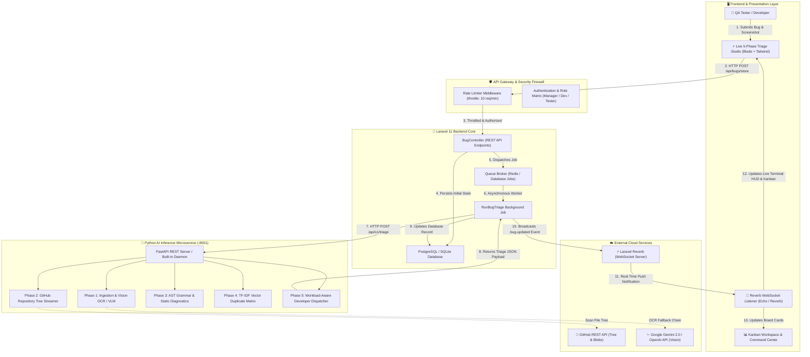
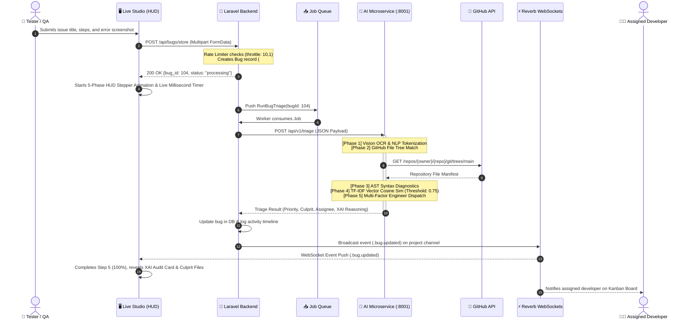

# AutoBugTriage: System Architecture & Data Flow

AutoBugTriage is an enterprise-grade, human-in-the-loop autonomous bug tracking and triaging platform. It bridges the gap between non-technical QA testers, codebase repositories, and software development teams through Explainable AI (XAI), static AST code analysis, and real-time WebSocket telemetry.

---

## 1. High-Level System Architecture Diagram

---

## 2. Real-Time Asynchronous Sequence Diagram

---

## 3. Technology Stack & Architectural Layers

| Layer | Technologies | Responsibilities |
| :--- | :--- | :--- |
| **Presentation Layer** | Blade Templates, Tailwind CSS, Alpine/Vanilla JS | Light glassmorphic modern SaaS UI, 5-Phase live terminal HUD modal, reactive Kanban board. |
| **Real-time Telemetry** | Laravel Reverb, Pusher Protocol, Echo JS | Low-latency bi-directional WebSockets for live status updates and notifications. |
| **API Gateway & Core** | Laravel 11 (PHP 8.2), Composer, Apache / Caddy | Authentication, role permissions, rate limiting (`throttle:10,1`), audit logging. |
| **Data Persistence** | PostgreSQL 16 (Render/Supabase) / SQLite (Local) | Relational schema for bugs, projects, developer skills matrix, activities, and comments. |
| **AI Inference Service** | Python 3.11+, FastAPI, Uvicorn, Scikit-learn, AST | Persistent microservice on port 8001 executing TF-IDF vector matching, AST syntax parsing, and GitHub file isolation. |
| **Multimodal Vision** | Google Gemini 2.0 Flash / GPT-4o-mini / RapidOCR | Tiered fallback chain to parse error messages and stack traces from screenshots. |
| **CI/CD & DevOps** | GitHub Actions, Docker, Render Cloud | Automated test execution on every commit with automatic zero-downtime production deployment. |

---

## 4. Explainable AI (XAI) Multi-Factor Decision Formula

AutoBugTriage eliminates the "black box" problem by evaluating developer assignments using a transparent multi-factor scoring function:

$$\text{Score}(D_i) = \alpha \cdot \text{TaxonomyMatch}(D_i, F) - \beta \cdot \text{ActiveQueue}(D_i) + \gamma \cdot \text{PastResolutions}(D_i, F)$$

Where:
- $\text{TaxonomyMatch}(D_i, F)$: Jaccard token overlap between developer skills and the bug's detected feature domain.
- $\text{ActiveQueue}(D_i)$: Penalty based on the developer's current in-progress task count compared to team mean.
- $\text{PastResolutions}(D_i, F)$: Historical fix velocity for similar issues.

All decisions are recorded and presented in the **Explainable AI Decision Audit Card** inside the UI.

